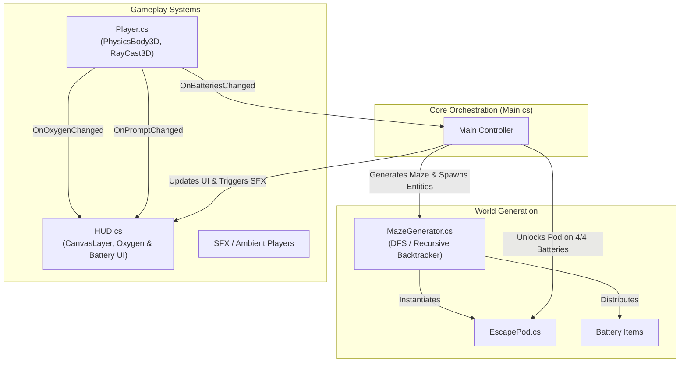

# 🚀 Nave 9: Evacuation

<div align="center">

-478CBF?style=for-the-badge&logo=godotengine&logoColor=white)


**A high-stakes 3D sci-fi evacuation survival game built with Godot 4 and C# (.NET).**

*Trapped aboard the decaying exploration vessel Nave 9, your life support is critically failing. Navigate an ever-shifting procedural labyrinth, retrieve essential power batteries, and unlock the escape pod before your oxygen runs out.*

</div>

---

## 🎮 Gameplay Overview

In **Nave 9: Evacuation**, players find themselves stranded in a derelict space vessel with a compromised life-support system. Time is your primary enemy:

1. **Survive the Depletion:** Oxygen reserves deplete in real-time. Keep moving and stay focused.
2. **Scavenge Support Batteries:** Explore the modular corridors to locate **4 hidden power batteries** scattered across the vessel.
3. **Unlock the Escape Pod:** Once all batteries are plugged in, the evacuation console powers online. Reach the pod to evacuate and survive.

---

## 🌟 Key Features

- 🌀 **Procedural 3D Maze Generation:** Every run builds a brand-new maze matrix using recursive backtracking algorithms, ensuring unpredictable routes and high replayability.
- ⏱️ **Atmospheric Survival Tension:** Real-time HUD telemetry monitors oxygen levels with dynamic color transitions and alert states.
- 📱 **Seamless Cross-Platform Controls:**
  - **Desktop (PC):** First-person WASD movement with captured mouse-look camera.
  - **Mobile (Android):** Custom on-screen virtual joystick, right-screen touch drag for camera rotation, and contextual interaction touch buttons.
- 🎧 **Dynamic Audio & Visual Feedback:** Immersive ambient soundscape, spatial lighting, emissive materials for objectives, and audio cues upon collecting items and unlocking the escape pod.
- 🧩 **Decoupled Event-Driven Architecture:** Clean C# implementation using delegates and events to isolate player state from UI and world management.

---

## 🏗️ Architecture & Technical Highlights



### Technical Design Patterns & Best Practices
- **Event-Driven UI (Observer Pattern):** Player systems emit C# `event Action` delegates (`OnOxygenChanged`, `OnBatteriesChanged`, `OnPromptChanged`). The `HUD` remains reactive without hard references to player internals.
- **Memory Safety & Lifecycle Handling:** Robust subscription cleanup in `_ExitTree()` utilizing `GodotObject.IsInstanceValid()` to prevent dangling delegate references and `ObjectDisposedException` across scene transitions.
- **Flexible Dependency Resolution:** Scene controllers utilize `[Export]` node references with defensive fallback lookups, allowing frictionless Inspector adjustments without breaking runtime tree structures.
- **RayCast Interaction Pipeline:** First-person interaction is handled via dedicated raycasting, supporting both keyboard (`[E]`) and touch UI button inputs.

---

## 🕹️ Controls

### PC (Keyboard & Mouse)
| Action | Key / Input |
| :--- | :--- |
| **Move** | `W`, `A`, `S`, `D` / Arrow Keys |
| **Look Around** | Mouse Motion |
| **Interact / Collect** | `E` |
| **Toggle Mouse Cursor** | `Esc` (`ui_cancel`) |

### Mobile (Touchscreen)
| Action | Touch Gesture |
| :--- | :--- |
| **Move** | Left Virtual Joystick |
| **Look Around** | Swipe / Drag on Right Half of Screen |
| **Interact / Collect** | Dedicated "PEGAR" On-Screen Button |

---

## 📁 Project Structure

```text
nave-9-evacuation/
├── Assets/                # Textures, normal maps, and audio WAV files
├── Scenes/                # Godot scene files (.tscn)
│   ├── Main.tscn          # Primary game level scene
│   ├── Player.tscn        # Character controller with Camera & RayCast
│   ├── MazeGenerator.tscn # Procedural dungeon builder
│   ├── EscapePod.tscn     # Evacuation vessel & trigger zone
│   ├── Battery.tscn       # Collectible power units
│   ├── HUD.tscn           # On-screen telemetry & mobile controls
│   ├── Menu.tscn          # Main start menu
│   ├── GameOver.tscn      # Oxygen depletion fail scene
│   └── Victory.tscn       # Successful evacuation scene
├── Scripts/               # C# gameplay logic (.cs)
│   ├── Main.cs            # Master game loop & wiring
│   ├── Player.cs          # Physics movement, oxygen loop, raycast
│   ├── MazeGenerator.cs   # Matrix generation & entity spawning
│   ├── EscapePod.cs       # Console lighting & exit trigger
│   ├── HUD.cs             # Interface meters & mobile inputs
│   ├── Battery.cs         # Pick-up lifecycle
│   └── VirtualJoystick.cs # Custom touch screen analog stick
├── ANALISE_MAIN.md        # Technical code review & improvement report
└── Nave9_Evacuation.csproj# .NET project configuration
```

---

## ⚙️ Requirements & How to Run

### Prerequisites
- [Godot Engine 4.x (.NET version)](https://godotengine.org/download)
- [.NET SDK 8.0](https://dotnet.microsoft.com/download/dotnet/8.0) or higher

### Steps to Run
1. Clone this repository:
   ```bash
   git clone https://github.com/your-username/nave-9-evacuation.git
   ```
2. Open **Godot Engine 4 (.NET)**.
3. Click **Import** and select the `project.godot` file in the root folder.
4. Build the C# solution inside Godot (or execute `dotnet build` from the terminal).
5. Press **F5** (or click the Play button in Godot) to launch the project.

---

## 👨‍💻 Developer & Portfolio Highlights

This project was developed to demonstrate:
- **Game Programming with C# & Godot 4:** Object-oriented design, events/delegates, and procedural generation algorithms.
- **Cross-Platform UX Design:** Unified gameplay feel across traditional desktop input and responsive mobile touch controls.
- **Clean Code & Robust Game Architecture:** Clear separation between presentation (HUD), simulation (Player physics), and orchestration (Main controller).

---
*Developed with passion for game design and high-performance C# architecture.*
